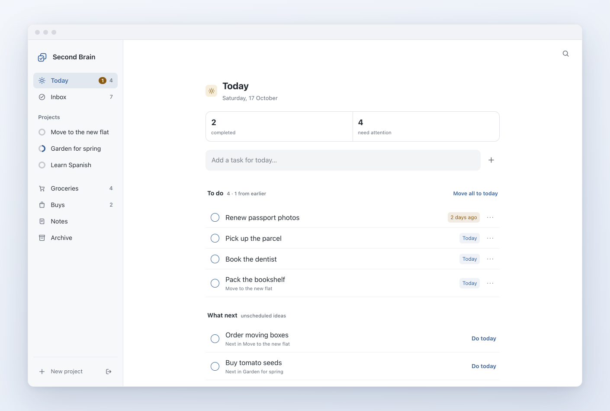
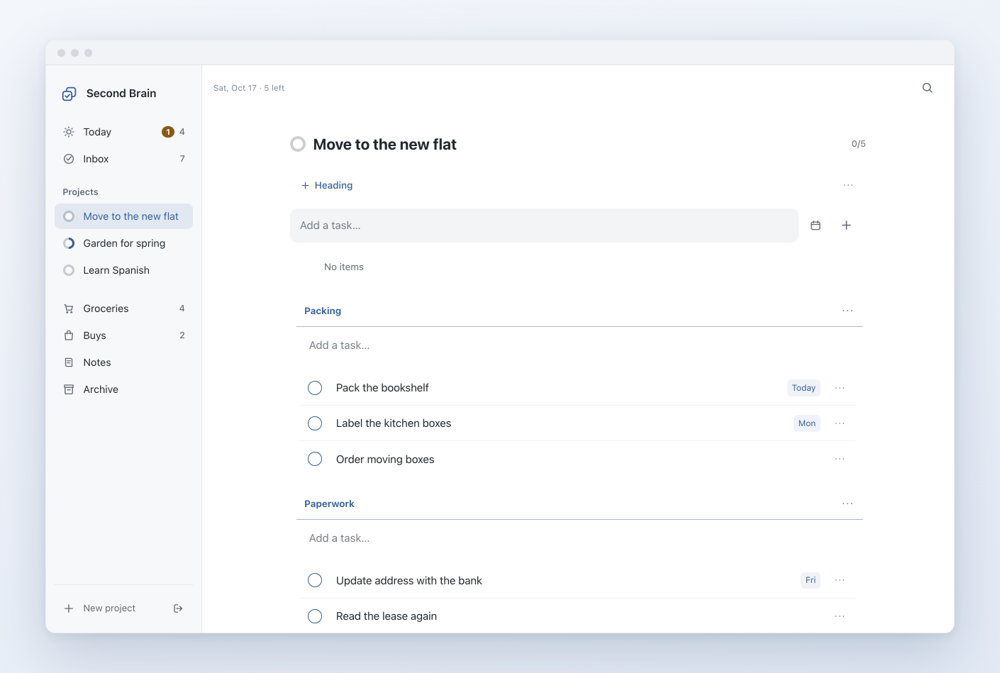
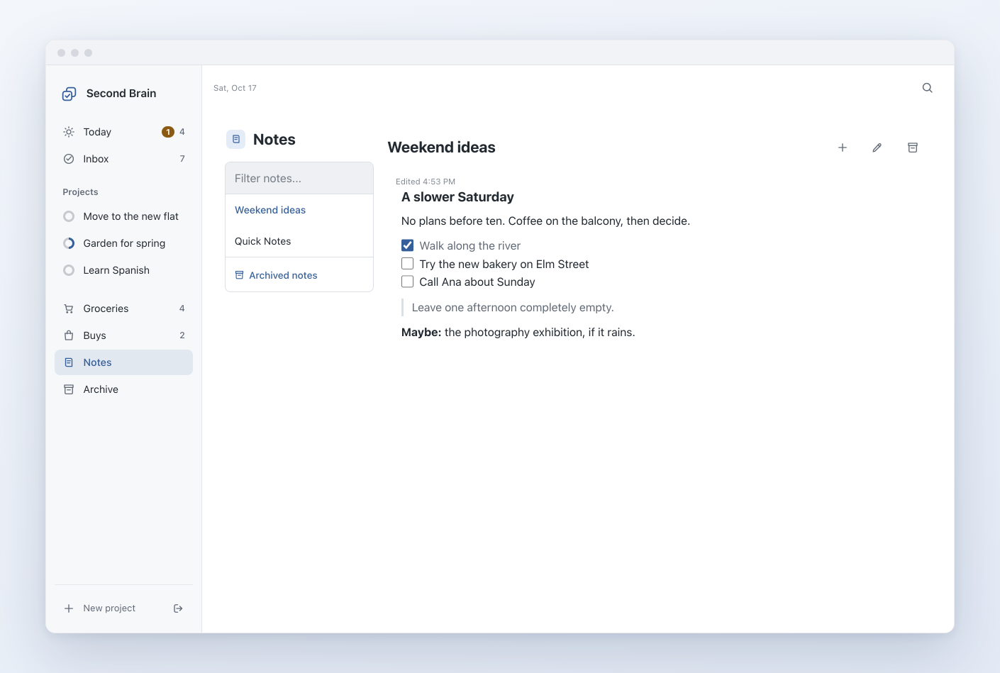
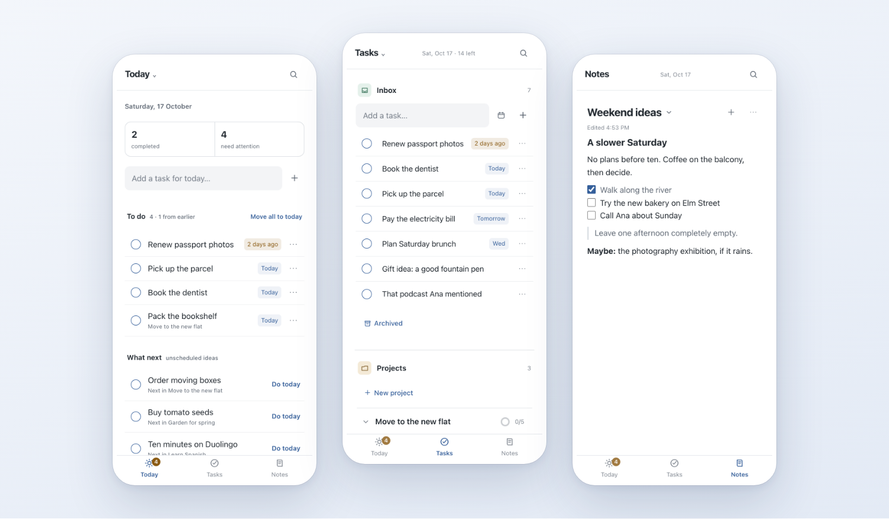

<div align="center">
  

  # Second Brain

  ### Everything on your mind. One calm place to put it.

  Tasks, projects, notes and lists in one quiet app that runs on your own server.<br>
  No account, no subscription, no one else holding your thoughts.

  [**Get started in two minutes →**](#get-started-in-two-minutes)

  <br>

  <picture>
    <source media="(prefers-color-scheme: dark)" srcset="docs/images/today-dark.png">
    
  </picture>
</div>

<br>

## Your head was never meant to be a to-do list

Most productivity apps want you to organise before you can begin. They ask for
a project, a priority, a label and a due date, then greet you the next morning
with a wall of red. So the list gets abandoned, and everything moves back into
your head.

Second Brain takes the opposite view. **Getting it out of your head is the
whole job.** Organising can wait, and missing a day should never feel like
failing.

<table>
  <tr>
    <td width="33%" valign="top">
      <h3>✍️ Capture first</h3>
      Type it and press Return. No list, date or project required.
      Add “tomorrow” or “fri” to the end and the date is set for you.
    </td>
    <td width="33%" valign="top">
      <h3>🌤️ Calm by design</h3>
      Nothing turns red. Missed dates show in a soft amber, and one tap moves
      them all to today. Starting again is a feature, not a confession.
    </td>
    <td width="33%" valign="top">
      <h3>🔒 Yours, properly</h3>
      One small app and one database file on a server you control.
      No accounts, no analytics, no cloud in between.
    </td>
  </tr>
</table>

<br>

## Today, and only today

Open the app and you see one thing: what deserves your attention now. Today
gathers what is due, carries forward anything from earlier without judgement,
and offers a few unscheduled ideas under **What next**, each with a plain note
on where it came from. One tap brings an idea into today.

Dates read the way people talk: *Today*, *Tomorrow*, *Fri*, *in 9 days*. And
when nothing is due, the daily reminder simply stays quiet.

<br>

## Big plans, small steps

<picture>
  <source media="(prefers-color-scheme: dark)" srcset="docs/images/project-dark.png">
  
</picture>

Moving house, planting a garden, learning a language. Give the bigger things a
project, split them under headings, and watch a small progress ring fill as you
go. Each project opens as its own page, so you only ever see one at a time.

Routines take care of themselves: a task can repeat daily, weekly, monthly or
yearly. Check it off and the next one is already waiting on its date.

<br>

## Notes that save themselves

<picture>
  <source media="(prefers-color-scheme: dark)" srcset="docs/images/notes-dark.png">
  
</picture>

Somewhere for the thoughts that are not tasks yet. Write in plain text or a
little Markdown, with headings, checklists, quotes and bold, and it reads
beautifully the moment you stop typing. Every word saves as you go, and a draft
survives a lost connection. Already keep notes as Markdown files? Drop them on
Notes from your computer and each one becomes a note.

<br>

## The lists you keep coming back to

**Groceries** and **Buys** sit apart from your tasks, so the oat milk never
crowds out the important things. Familiar items are remembered, which makes the
weekly shop a matter of a few taps.

<br>

## In your pocket, too

<picture>
  <source media="(prefers-color-scheme: dark)" srcset="docs/images/phones-dark.png">
  
</picture>

Add it to your Home Screen and it opens like a native app, with three tabs and
nothing else: **Today**, **Tasks** and **Notes**. Controls are sized for thumbs,
light and dark follow your device, and the last page you opened is still there
when you are offline.

<br>

## Small promises, kept

| | |
| --- | --- |
| **Everything is reversible** | Archive, complete, move or reschedule, and undo is one tap away. Nothing is deleted until you say so twice. |
| **Nothing is hidden from you** | Overdue tasks are never tucked away or capped. They lead Today, gently. |
| **One reminder a day, at most** | A single morning nudge with what is due. Silent on days with nothing on. |
| **No streaks, no scores** | Your worth is not a number of completed tasks. |
| **Find anything** | One search across tasks, projects and notes, including what you have archived. |
| **Backed up every night** | A fresh copy of your database each day, the last seven kept. |

<br>

## Built for brains that get overwhelmed

Second Brain started as a personal tool for someone who finds busy, demanding
apps hard to live with. Every screen follows the same few rules: show less,
offer one obvious next step, never use colour to scold, and make it easy to
start over. It turns out that is a nicer way for anyone to work.

<br>

## Get started in two minutes

You will need a machine with Docker. Create a `.env` file with your own
eight-digit passcode, time zone and reminder time:

```dotenv
PASSCODE=12345678
TZ=Europe/London
TASK_REMINDER_TIME=09:00
```

Then start it:

```bash
mkdir -p data
docker compose up -d
```

Open [http://localhost:8080](http://localhost:8080), enter your passcode, and
add the first thing on your mind.

<details>
<summary><strong>Backups, reverse proxies, upgrades and importing notes</strong></summary>

<br>

- **Backups.** A snapshot of the database is written to `data/backups` every
  day, and the last seven are kept. `BACKUP_KEEP` changes the count (`0` turns
  it off). To keep them on another disk, set `BACKUP_PATH` in `.env` with
  Docker Compose, or `BACKUP_DIR` when running the binary directly. The folder
  must be writable by UID 1000 in the container.
- **Behind a reverse proxy.** Set `TRUSTED_PROXY` to the proxy's IP or CIDR
  range, so failed sign-ins lock out only the device that made them.
- **Upgrades.** See [the upgrade guide](docs/UPGRADE.md).
- **Importing notes.** Besides dragging files in, `scripts/push-note.cjs`
  imports a folder of `.md` files from the command line, and skips names you
  already have, so running it again is safe.

</details>

<br>

## Under the hood

One Go binary, one SQLite file and a server-rendered interface with no build
step. It is small enough to read in an afternoon. Developers can start with
[the architecture](docs/ARCHITECTURE.md) and the
[development guide](docs/DEVELOPMENT.md).

<br>

<div align="center">
  <sub>Made for one person at a time. Yours.</sub>
</div>
